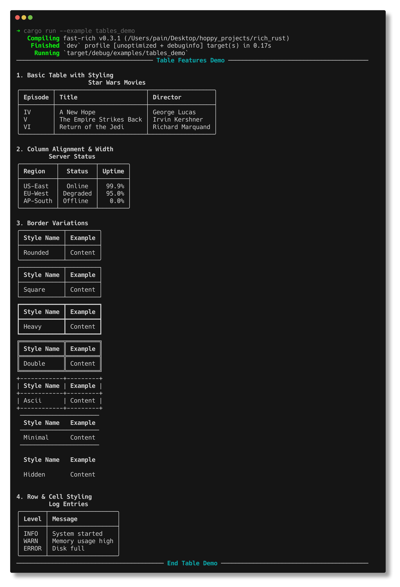

# Tables

Fast-Rich provides beautiful, customizable tables with Unicode borders, auto-sizing columns, and cell styling.

## Quick Example

```rust
use fast_rich::prelude::*;

fn main() {
    let console = Console::new();
    
    let mut table = Table::new();
    table.add_column("Name");
    table.add_column("Role");
    table.add_row_strs(&["Alice", "Admin"]);
    table.add_row_strs(&["Bob", "Developer"]);
    
    console.print_renderable(&table);
}
```

**Output:**
```
╭───────┬───────────╮
│ Name  │ Role      │
├───────┼───────────┤
│ Alice │ Admin     │
│ Bob   │ Developer │
╰───────┴───────────╯
```

---

## Creating Tables

### Basic Structure

```rust
let mut table = Table::new();

// Add columns (headers)
table.add_column("Column 1");
table.add_column("Column 2");
table.add_column("Column 3");

// Add rows (data)
table.add_row_strs(&["A1", "B1", "C1"]);
table.add_row_strs(&["A2", "B2", "C2"]);
```

### Table Title

Add a centered title above the table:

```rust
let mut table = Table::new().title("User Statistics");
table.add_column("Metric");
table.add_column("Value");
table.add_row_strs(&["Users", "1,234"]);
```

**Output:**
```
     User Statistics     
╭────────┬───────╮
│ Metric │ Value │
├────────┼───────┤
│ Users  │ 1,234 │
╰────────┴───────╯
```

---

## Column Configuration

### Column Alignment

Control how content is aligned within columns:

```rust
use fast_rich::table::ColumnAlign;

let mut table = Table::new();
table.add_column_with("ID", Column::new().align(ColumnAlign::Right));
table.add_column_with("Name", Column::new().align(ColumnAlign::Left));
table.add_column_with("Status", Column::new().align(ColumnAlign::Center));

table.add_row_strs(&["1", "Alice", "Active"]);
table.add_row_strs(&["123", "Bob", "Pending"]);
```

**Output:**
```
╭─────┬───────┬─────────╮
│  ID │ Name  │ Status  │
├─────┼───────┼─────────┤
│   1 │ Alice │ Active  │
│ 123 │ Bob   │ Pending │
╰─────┴───────┴─────────╯
```

### Alignment Options

| Alignment | Description |
|:----------|:------------|
| `ColumnAlign::Left` | Left-align content (default) |
| `ColumnAlign::Right` | Right-align content |
| `ColumnAlign::Center` | Center content |

---

## Border Styles

Tables support multiple border styles:

=== "Rounded (Default)"

    ```rust
    table.border_style(BorderStyle::Rounded);
    ```
    ```
    ╭────────┬─────────╮
    │ Name   │ Value   │
    ├────────┼─────────┤
    │ Item   │ Data    │
    ╰────────┴─────────╯
    ```

=== "Square"

    ```rust
    table.border_style(BorderStyle::Square);
    ```
    ```
    ┌────────┬─────────┐
    │ Name   │ Value   │
    ├────────┼─────────┤
    │ Item   │ Data    │
    └────────┴─────────┘
    ```

=== "Heavy"

    ```rust
    table.border_style(BorderStyle::Heavy);
    ```
    ```
    ┏━━━━━━━━┳━━━━━━━━━┓
    ┃ Name   ┃ Value   ┃
    ┣━━━━━━━━╋━━━━━━━━━┫
    ┃ Item   ┃ Data    ┃
    ┗━━━━━━━━┻━━━━━━━━━┛
    ```

=== "Double"

    ```rust
    table.border_style(BorderStyle::Double);
    ```
    ```
    ╔════════╦═════════╗
    ║ Name   ║ Value   ║
    ╠════════╬═════════╣
    ║ Item   ║ Data    ║
    ╚════════╩═════════╝
    ```

=== "ASCII"

    ```rust
    table.border_style(BorderStyle::Ascii);
    ```
    ```
    +-------------+
    | Name  | Qty |
    |-------+-----|
    | apple |   3 |
    | kiwi  |  12 |
    +-------------+
    ```

=== "Minimal"

    ```rust
    table.border_style(BorderStyle::Minimal);
    ```
    ```
            ╷
      Name  │ Qty
    ╶───────┼─────╴
      apple │   3
      kiwi  │  12
            ╵
    ```

=== "Simple"

    ```rust
    table.border_style(BorderStyle::Simple);
    ```
    ```

      Name    Qty
     ─────────────
      apple     3
      kiwi     12

    ```

=== "Markdown"

    ```rust
    table.border_style(BorderStyle::Markdown);
    ```
    ```

    | Name  | Qty |
    |-------|-----|
    | apple |   3 |
    | kiwi  |  12 |

    ```

All 19 of Rich's boxes are available, with the same characters as
`rich.box` (checked against Rich 15 by `tests/box_rich_parity.rs`):

| `BorderStyle` | `box_drawing` constant | Rich |
|:--|:--|:--|
| `Ascii`, `Ascii2`, `AsciiDoubleHead` | `ASCII`, `ASCII2`, `ASCII_DOUBLE_HEAD` | `box.ASCII`, ... |
| `Square`, `SquareDoubleHead` | `SQUARE`, `SQUARE_DOUBLE_HEAD` | |
| `Minimal`, `MinimalHeavyHead`, `MinimalDoubleHead` | `MINIMAL`, ... | |
| `Simple`, `SimpleHead`, `SimpleHeavy` | `SIMPLE`, `SIMPLE_HEAD`, `SIMPLE_HEAVY` | |
| `Horizontals`, `Rounded` (default) | `HORIZONTALS`, `ROUNDED` | |
| `Heavy`, `HeavyEdge`, `HeavyHead` | `HEAVY`, `HEAVY_EDGE`, `HEAVY_HEAD` | |
| `Double`, `DoubleEdge` | `DOUBLE`, `DOUBLE_EDGE` | |
| `Markdown` | `MARKDOWN` | |

Plus `Hidden` (spaces) and `Custom(BoxStyle)`. As in Rich, a table with
`show_header(false)` draws a headed box without its header line
(`HeavyHead` and `SquareDoubleHead` become `Square`, the `Minimal*Head`
boxes `Minimal`, `AsciiDoubleHead` becomes `Ascii2`; see
`BorderStyle::plain_headed`). `SimpleHead` differs from `Simple` only in
the line above a footer, which fast-rich tables don't have yet. Rich's
substitution of boxes on legacy Windows consoles and ASCII-only
terminals (`Box.substitute`) is not ported.

---

## Styled Cells

Add colors and formatting to individual cells:

```rust
use fast_rich::prelude::*;

let mut table = Table::new();
table.add_column("Level");
table.add_column("Message");

// Use Text objects with styles
table.add_row(vec![
    fast_rich::markup::parse("[green]INFO[/]"),
    Text::plain("System started"),
]);
table.add_row(vec![
    fast_rich::markup::parse("[yellow]WARN[/]"),
    Text::plain("Low memory"),
]);
table.add_row(vec![
    fast_rich::markup::parse("[red]ERROR[/]"),
    Text::plain("Connection failed"),
]);
```

**Output:**
```
╭───────┬───────────────────╮
│ Level │ Message           │
├───────┼───────────────────┤
│ INFO  │ System started    │
│ WARN  │ Low memory        │
│ ERROR │ Connection failed │
╰───────┴───────────────────╯
```

---

## Real Terminal Output

!!! example "Run the tables demo"

    **Command:**
    ```bash
    cargo run --example tables_demo
    ```

    **What you'll see:**

    

---

## Tips

!!! tip "Auto-sizing"
    Columns automatically expand to fit their content. The table adapts 
    to the terminal width.

!!! tip "Unicode Headers"
    Use emoji and symbols in headers:
    ```rust
    table.add_column("✅ Status");
    table.add_column("📊 Metric");
    ```

!!! warning "Wide Content"
    Very wide content may cause horizontal scrolling or wrapping depending on 
    terminal width. Consider truncating or abbreviating long text.
