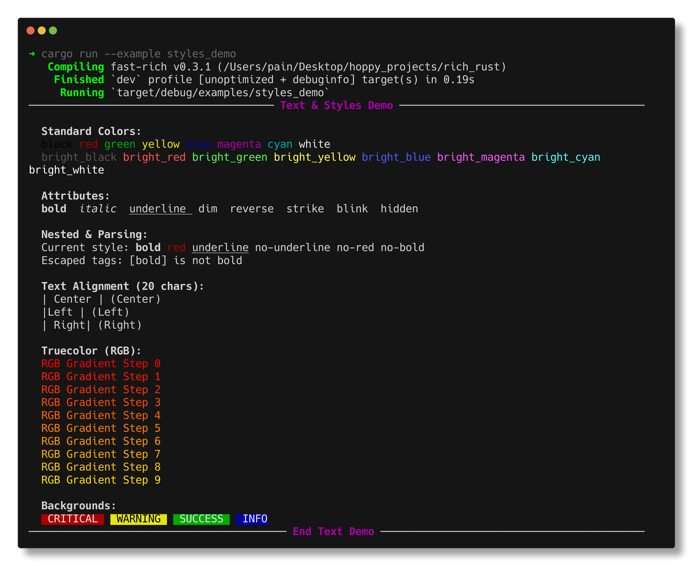

# Text & Styles

Fast-Rich provides a powerful text styling system with support for colors, attributes, and a convenient markup syntax.

## Quick Example

```rust
use fast_rich::prelude::*;

fn main() {
    let console = Console::new();
    
    console.print("[bold red]Error:[/] Something went wrong");
    console.print("[italic blue]Hint:[/] Check your configuration");
}
```

---

## Color System

Fast-Rich supports multiple color modes that adapt to terminal capabilities:

### Standard Colors (8 Colors)

The basic colors available on all terminals:

```rust
console.print("[black]black[/] [red]red[/] [green]green[/] [yellow]yellow[/]");
console.print("[blue]blue[/] [magenta]magenta[/] [cyan]cyan[/] [white]white[/]");
```

### Bright Colors (16 Colors)

Brighter variants available on most terminals:

```rust
console.print("[bright_red]bright_red[/] [bright_green]bright_green[/]");
console.print("[bright_blue]bright_blue[/] [bright_magenta]bright_magenta[/]");
```

### RGB/Truecolor (16 Million Colors)

For terminals with truecolor support:

```rust
console.print("[color(255,100,0)]Orange[/]");
console.print("[color(0,255,128)]Spring Green[/]");
console.print("[color(128,0,255)]Purple[/]");
```

### Background Colors

Use `on` to set background colors:

```rust
console.print("[white on blue] White text on blue background [/]");
console.print("[black on yellow] Warning style [/]");
console.print("[white on color(200,0,0)] Custom red background [/]");
```

---

## Style Attributes

Apply formatting effects to text:

| Attribute | Syntax | Description |
|:----------|:-------|:------------|
| Bold | `[bold]` | **Bold text** |
| Italic | `[italic]` | *Italic text* |
| Underline | `[underline]` | <u>Underlined text</u> |
| Strike | `[strike]` | ~~Strikethrough~~ |
| Dim | `[dim]` | Dimmed/faded text |
| Reverse | `[reverse]` | Swap foreground/background |
| Blink | `[blink]` | Blinking text (limited support) |
| Rapid blink | `[blink2]` | Fast blinking text (SGR 6, rarely supported) |
| Conceal | `[conceal]` or `[hidden]` | Hidden text |
| Double underline | `[underline2]` or `[uu]` | Double underline (SGR 21) |
| Overline | `[overline]` or `[o]` | Line above the text (SGR 53) |
| Frame | `[frame]` | Framed text (SGR 51, rarely supported) |
| Encircle | `[encircle]` | Encircled text (SGR 52, rarely supported) |

```rust
console.print("[bold]Bold[/] [italic]Italic[/] [underline]Underline[/]");
console.print("[strike]Strike[/] [dim]Dim[/] [reverse]Reverse[/]");
console.print("[uu]Double underline[/] [o]Overline[/] [frame]Frame[/]");
```

These are Rich's 13 attributes, written with Rich's SGR codes. Prefix
`not` to turn one off (`[bold not underline]`). Rich's abbreviations work
too: `b`, `d`, `i`, `u`, `uu`, `o`, `r`, `s`, `c`. In HTML export,
underline, strike and overline share one `text-decoration`; blink, frame
and encircle have no CSS form and are dropped, as in Rich.

### Combining Styles

Combine multiple styles in one tag:

```rust
console.print("[bold italic red]Bold italic red text[/]");
console.print("[underline blue on white]Underlined blue on white[/]");
```

---

## Markup Syntax

### Basic Tags

Wrap text in `[style]...[/]` to apply styles:

```rust
console.print("[bold]This is bold[/]");
console.print("[red]This is red[/]");
```

### Nesting Styles

Styles can be nested:

```rust
console.print("[bold]Bold [italic]and italic[/italic] just bold[/]");
console.print("[red]Red [blue]with blue inside[/blue] back to red[/]");
```

### Negating Styles

Use `no-` prefix to remove a style:

```rust
console.print("[bold]Bold [no-bold]not bold[/no-bold] bold again[/]");
console.print("[red]Red [no-red]default color[/no-red] red again[/]");
```

### Escaping Brackets

To display literal brackets, use backslash:

```rust
console.print("Use \\[bold] to show [bold] literally");
// Output: Use [bold] to show [bold] literally
```

---

## The Style Struct

For programmatic styling, use the `Style` struct:

```rust
use fast_rich::prelude::*;

let style = Style::new()
    .foreground(Color::Red)
    .background(Color::White)
    .bold()
    .underline();

let text = Text::styled("Styled text", style);
console.print_renderable(&text);
```

### Style Builder Methods

| Method | Description |
|:-------|:------------|
| `.foreground(Color)` | Set text color |
| `.background(Color)` | Set background color |
| `.bold()` | Make text bold |
| `.italic()` | Make text italic |
| `.underline()` | Add underline |
| `.strikethrough()` | Add strikethrough |
| `.dim()` | Make text dim |
| `.reverse()` | Swap fg/bg colors |
| `.blink()` / `.blink2()` | Slow / rapid blink |
| `.hidden()` | Conceal the text |
| `.underline2()` | Double underline |
| `.overline()` | Line above the text |
| `.frame()` / `.encircle()` | Framed / encircled text |

### Color Enum

```rust
use fast_rich::Color;

// Named colors
let red = Color::Red;
let bright_blue = Color::BrightBlue;

// RGB colors
let orange = Color::Rgb(255, 128, 0);

// 256-color palette
let color_123 = Color::Ansi256(123);
```

---

## Text Alignment

Align text within a specified width:

```rust
use fast_rich::prelude::*;

let left = Text::from("Left").alignment(Alignment::Left);
let center = Text::from("Center").alignment(Alignment::Center);
let right = Text::from("Right").alignment(Alignment::Right);

console.print_renderable(&left);
console.print_renderable(&center);
console.print_renderable(&right);
```

---

## Working with Text

`Text` has the same editing methods as Python Rich's `Text`. Offsets are
**byte offsets** (what `str::find` returns); an offset inside a multibyte
character snaps down to its start. Widths are terminal cells.

### Styling ranges

```rust
use fast_rich::prelude::*;

let mut text = Text::plain("Error: disk full on /dev/sda1");
text.stylize(Style::new().bold().foreground(Color::Red), 0, 5); // on top
text.stylize_before(Style::new().italic(), 0, usize::MAX);     // underneath
text.highlight_words(["disk"], Style::new().underline(), false);

// Ranges you found yourself (no regex needed):
let plain = text.plain_text();
let ranges = plain.match_indices("/dev").map(|(i, m)| i..i + m.len());
text.highlight_matches(ranges.collect::<Vec<_>>(), Style::new().foreground(Color::Cyan));

assert!(text.get_style_at_offset(0).bold);
```

With the `regex` feature: `text.highlight_regex(&Regex::new(r"\d+")?, style)`.

### Building and joining

```rust
use fast_rich::prelude::*;

let mut line = Text::assemble([Text::from(Span::styled("key", Style::new().bold())), Text::from("=")]);
line.append_tokens([("42", Style::new().foreground(Color::Cyan))]);
line.append_text(&Text::plain(" (ok)"));

let list = Text::plain(", ").join([Text::plain("a"), Text::plain("b")]);
assert_eq!(list.plain_text(), "a, b");
```

### Cutting, cropping and padding

| Method | Does |
|:-------|:-----|
| `divide(offsets)` | Cut at byte offsets into `offsets.len() + 1` pieces |
| `split(sep, include_separator)` | Split on a separator, keeping styles |
| `fit(width)` | Split into lines, each exactly `width` cells |
| `truncate(width, overflow, pad)` | Crop to `width` cells (`Overflow::Ellipsis` adds `…`) |
| `set_length(width)` | Crop or pad with spaces to exactly `width` cells |
| `right_crop(n)` | Drop the last `n` characters |
| `pad(n, c)`, `pad_left`, `pad_right` | Add `n` copies of `c` |
| `rstrip()`, `rstrip_end(width)` | Drop trailing whitespace (all, or only beyond `width`) |
| `remove_suffix(s)` | Drop `s` from the end if present |

```rust
use fast_rich::prelude::*;
use fast_rich::text::Overflow;

let mut name = Text::plain("a_very_long_file_name.rs");
name.truncate(10, Some(Overflow::Ellipsis), false);
assert_eq!(name.plain_text(), "a_very_lo…");
```

### Code helpers

```rust
use fast_rich::prelude::*;

let mut code = Text::plain("fn main() {\n\tprintln!(\"hi\");\n}");
code.expand_tabs(4);
assert_eq!(code.detect_indentation(), 4);
let guided = code.with_indent_guides(None, '│', Style::new().dim());
console.print_renderable(&guided);
```

Differences from Rich: `set_length` and `fit` count cells (Rich counts
characters, so CJK text does not line up there); `right_crop(0)` and
`remove_suffix("")` do nothing (Rich empties the text); `highlight_regex`
does not turn named groups into theme styles.

### Text from ANSI escape codes

`Text::from_ansi` (Rich's `Text.from_ansi`) decodes a string that
already contains escape codes, such as the captured output of `cargo`,
`ls --color` or `git diff --color`, into styled `Text`. The escapes become
styles and links, so the text measures and wraps by its visible
characters and fits inside a `Panel` or `Table`:

```rust
use fast_rich::prelude::*;

let output = "\x1b[1m\x1b[92m    Finished\x1b[0m `dev` profile in 0.42s";
let text = Text::from_ansi(output);
assert_eq!(text.plain_text(), "    Finished `dev` profile in 0.42s");
console.print_renderable(&Panel::new(text).title("cargo"));
```

It decodes SGR attributes (and their "off" codes), 16 / 256 / truecolor
colors, `39` / `49` (default color), resets and OSC 8 hyperlinks
(`Span::link`). Cursor movement and other escapes are dropped, and each
line keeps only the text after its last `\r`, as a terminal would show
it. To decode line by line and keep the style across calls, use
`fast_rich::ansi::AnsiDecoder`. See `examples/ansi_demo.rs`.

Difference from Rich: OSC 8 links ended by BEL (`\x07`) are decoded;
Rich only accepts `ESC \` there and leaves the rest as text.

---

## Theme Style Names

Every built-in component looks its styles up by name in the console theme,
using Rich's names and Rich's default values (`rich/default_styles.py`,
154 styles). Override a name to restyle the component everywhere, like
Rich's `Console(theme=Theme({"table.header": "bold magenta"}))`:

```rust
use fast_rich::prelude::*;

let theme = Theme::from_styles([
    ("table.header", "bold magenta"),
    ("table.border", "bright_black"),
    ("bar.complete", "cyan"),
    ("rule.line", "dark_orange3"),
    ("logging.level.warning", "black on yellow"),
    ("repr.number", "bold magenta"),
]);
let console = Console::new().theme(theme);
console.rule("Results"); // dark orange line
```

The same names work as markup tags (`[repr.number]42[/]`), and a style set
on the component itself (`Table::header_style`, `Rule::style`,
`BarColumn::complete_style`, ...) still wins over the theme.

| Group | Names | Used by |
|:------|:------|:--------|
| `table.*` | `header`, `title`, `caption`, `cell`, `border` (fast-rich only, empty) | `Table` |
| `rule.*` | `line` (bright green), `text` | `Rule`, `console.rule` |
| `tree`, `tree.line` | base label style, guide lines | `Tree` |
| `bar.*` | `complete`, `finished`, `pulse`, `back` | `BarColumn`, `NestedProgress` |
| `progress.*` | `description`, `percentage`, `elapsed`, `remaining`, `data.speed`, `download`, `filesize`, `filesize.total`, `spinner` | progress columns |
| `status.spinner` | spinner frame | `Spinner` |
| `log.*`, `logging.level.*` | `time`, `level`, `message`, `path`; `debug`, `info`, `warning`, `error` | `LogMessage`, `console.log`, `RichLogger` |
| `traceback.*` | `border`, `title`, `exc_type`, `exc_value` | `Traceback` |
| `markdown.*` | `h1`..`h6`, `em`, `strong`, `s`, `code`, `code_block`, `link`, `link_url`, `block_quote`, `item.bullet`, `item.number`, `hr`, `table.border`, `table.header` | `Markdown` |
| `json.*` | `key`, `str`, `number`, `bool_true`, `bool_false`, `null`, `brace` | `Json`, `JsonHighlighter` |
| `prompt.*` | `prompt`, `choices`, `default`, `invalid`, `invalid.choice` | `Prompt` |
| `repr.*` | numbers, strings, URLs, ... | automatic highlighting, `Pretty` |

`theme::builtin_style_names()` lists all names. Style strings also accept
Rich's 256 named colors (`grey23`, `dark_orange3`, ...).

Differences from Rich: fast-rich styles have two states per attribute, so
Rich's `not bold` means "bold off" rather than "explicitly unset".

---

## Real Terminal Output

!!! example "Run the styles demo"

    **Command:**
    ```bash
    cargo run --example styles_demo
    ```

    **What you'll see:**

    
